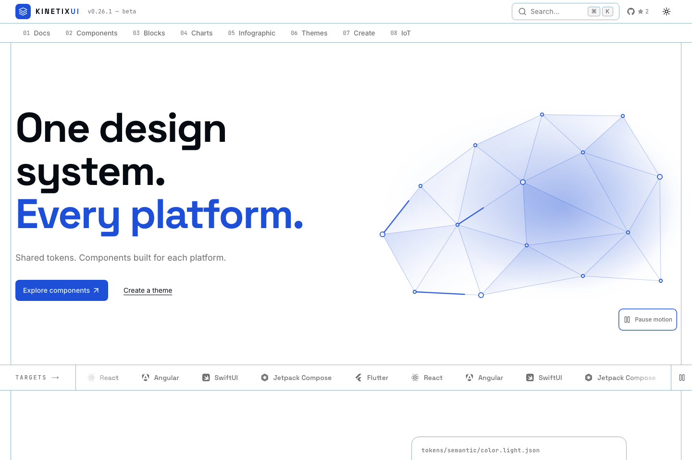
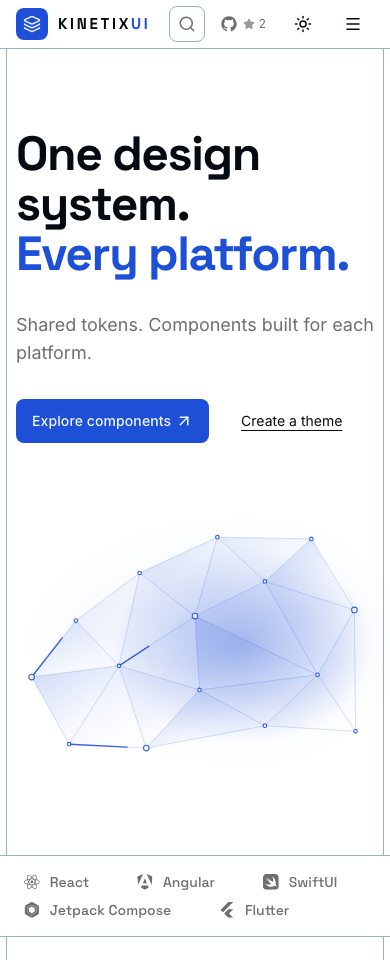

# Original-brand animated polygon hero — validation

This is a visual follow-up to PR #509. No changes to the published component packages, logo markup, or canonical brand token values.

- The homepage uses a **new inline SVG composition**, not the uploaded OH38WC1 paths or a static copied illustration.
- Its triangular facets, 15 nodes, connector lines and three animated signal routes inherit KinetixUI's original primary color from the theme.
- The local grayscale overrides to --primary, --foreground, --ring and --action are removed.
- The exact existing header/footer logo markup remains in place; the hero is simpler and uses a single primary component CTA.
- Motion pauses offscreen, on hidden tabs, on persisted user request and under reduced motion. No React frame-loop animation.
- Footer/Create preserve static decoration and all pre-existing Create preview/export contracts.

## Local verification on isolated macOS worktree

- TypeScript typecheck: passed.
- Production Next build: passed.
- Focused SVG motion/unit tests: 5/5 passed.
- polygon-refresh-browser: 16 homepage/Create configurations, zero overflow, zero axe violations, zero runtime errors.
- home-systems-browser: passed, including responsive hero bounds, visible CTA and worst-case rendered text contrast.
- git diff --check: passed.

## Screenshots

These are real local production-build captures, not generated images. The local testing worktree temporarily reused dependency node_modules from an older checkout, so the desktop screenshot's package-version label is stale. **Do not interpret that label as the actual published version**: the PR source is based on the published 0.27.0 main, and the registry/release evidence is tracked separately.

No production deployment or PR merge has been authorized.
