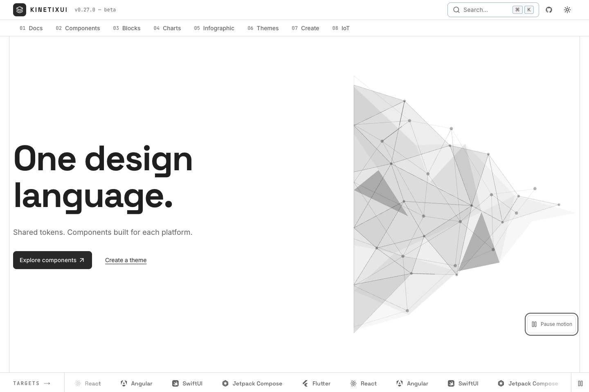
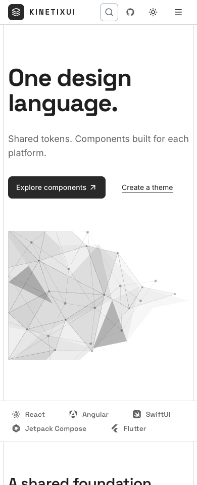
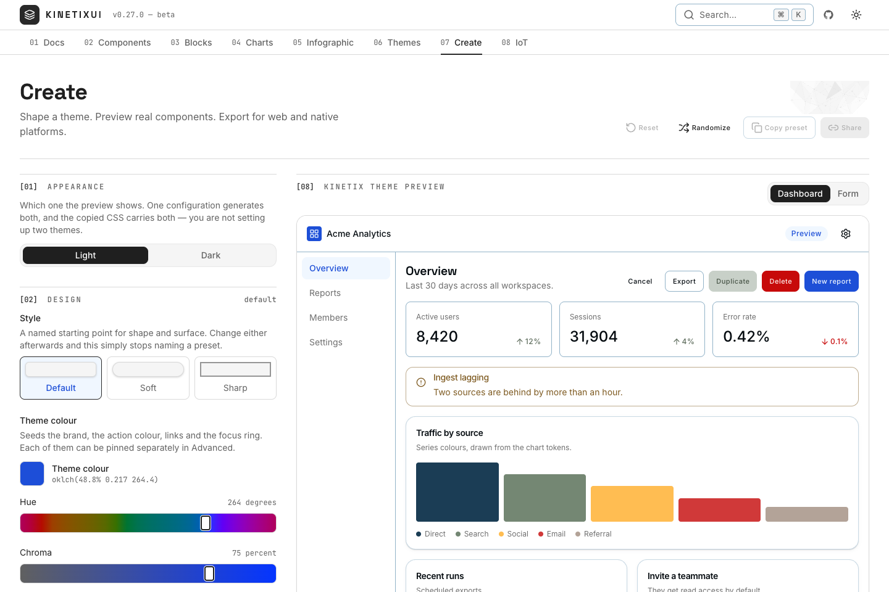
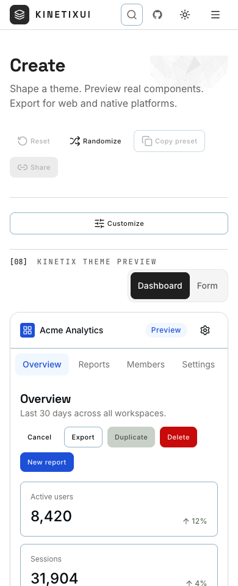

# Polygon visual refresh

Scope: homepage, shared website header/footer, and existing Create chrome. The owner-supplied grayscale `OH38WC1.svg`/JPG is the sole artwork reference. Source coordinates and provenance are recorded in `design-assets/polygon/REFERENCE.md`. The older engraving direction is superseded.

The homepage now leads with a short headline, one supporting sentence, one component CTA and a quiet Create link. Installation and detailed platform proof follow below. The supplied triangular facets, nodes and links replace landscape decoration. Create retains its real component preview and existing theme/export behavior; future Studio features remain roadmap.

Motion uses 114 fixed source shapes and three connector overlays, 16-second bounded group drift, 12-second connector strokes and 8-second node opacity. It uses CSS rather than frame-driven React updates. A remembered keyboard pause, intersection visibility, document visibility and live reduced-motion preference gate animation. Reduced motion leaves a complete static mesh. Footer and Create ornaments are static and do not intercept pointers.

Validation:

- Production build passed, including TypeScript and lint. Existing unused-variable warnings in unrelated tests remain.
- Website suite: 125 files, 2,579 tests passed. Focused tests were rerun after responsive fixes.
- Motion lifecycle tests cover offscreen/hidden-tab stopping, live reduced-motion changes, persisted pause and observer/listener cleanup.
- Spatial grid, RTL, typography, type-scale and website component-dogfooding guardrails passed. The motion control uses the existing library Toggle.
- Theme-isolation browser suite passed: Create edits, reset, navigation, light/dark preview isolation and focus rings.
- Browser matrix passed all 16 route/config cases with zero axe violations, horizontal overflow or runtime errors. Browser evidence covers homepage and Create in desktop, mobile, dark/RTL, narrow/tablet and doubled text. See `browser-results.json` for exact cases. Entrance effects are settled and lazy previews mounted for capture only; product behavior is unchanged by the capture override.
- Existing homepage browser suite retains keyboard/platform-map, headline, trace geometry, payload and rendered-pixel contrast checks. Decoration assertions now cover mesh/copy separation and a visible primary action instead of the removed glow.

Reproduce after building UI, IoT and web:

```sh
pnpm --filter @kinetixui/web exec next start -p 3000
node scripts/polygon-refresh-browser.mjs
node scripts/home-systems-browser.mjs --base http://127.0.0.1:3000
node scripts/theme-isolation.mjs --base http://127.0.0.1:3000
```

Captures below are screenshots of the local production build, not generated artwork. Full-page captures use half pixel scale to avoid Chromium’s long-page compositor limit; detailed viewport captures use full scale. Full-page and extended-matrix captures remain available in `.impeccable/review/` locally. No merge, deployment or package publication was performed.





