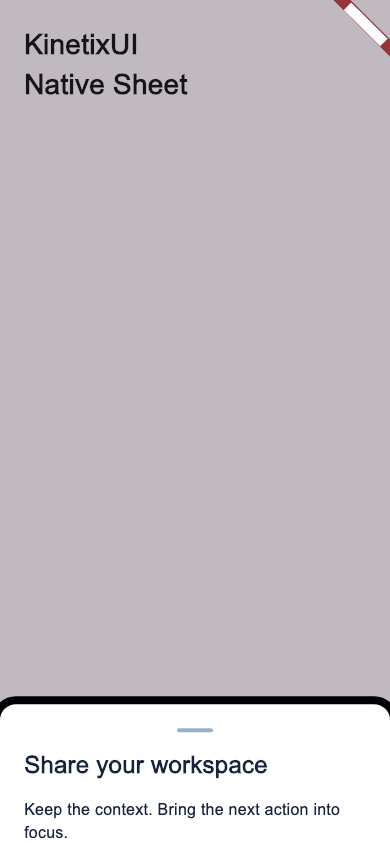
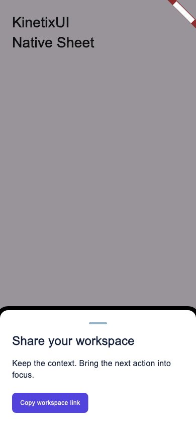
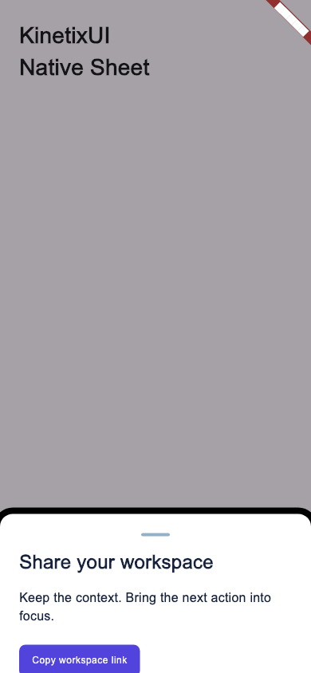

# Flutter Sheet and Drawer motion

`KinetixSheet` retains its existing controlled `visible`, `onDismiss`, and `child` API. Keep the widget mounted when setting `visible: false`; removing it directly cannot play an exit. `KinetixDrawer` delegates to the same implementation. Both remain bottom-only. No drag gesture or dependency is added.

One animation controller owns panel position and scrim opacity. Opening uses `KinetixDuration.slow`, closing uses `KinetixDuration.base`, and both use `KinetixEasing.standard`, consuming the existing `spatial` role. A reversal continues from the current position. The platform `MediaQuery.disableAnimationsOf` preference is observed live; both durations shorten to one microsecond, settling on the next frame without visible travel. The nonzero floor keeps completion callbacks scheduled during dependency changes.

The barrier remains mounted until exit completes, blocking background pointers and semantics. Focus enters the first control, Tab and Shift-Tab stay within the sheet, and the original focus returns after exit. Escape, the localized barrier action, and system back request controlled dismissal. A generation check cancels stale focus work after reversal or unmount. Native screen-reader operation still needs device verification.

```dart
Stack(children: [
  workspace,
  KinetixSheet(
    visible: sharing,
    onDismiss: () => setState(() => sharing = false),
    child: const KinetixSheetTitle('Share workspace'),
  ),
])
```

## Verification

- Flutter analyzer: no issues; full existing and new suite: 210 passing tests.
- `sheet_motion_test.dart`: 14 tests covering rendered opening and closing midpoints for Sheet and Drawer, coordinated scrim, both reduced-motion directions, interruption/reversal, live preference changes, initial focus, focus containment/restoration, Escape, system back, background pointer/semantics blocking, rapid updates/unmount, RTL and 200% text.
- Motion bookkeeping: native ledger, motion-token contract, registry and token-contract checks pass. Spatial remains `observed`; headless Flutter evidence does not establish equal native-device evidence across platforms.
- Negative control: restoring main’s static Sheet fails the rendered travel assertion; the fixed implementation passes.
- 49 native/token guard tests and all five consumer-identity negative controls pass.
- `verification.json` is regenerated from the tests; the second generation must be byte-identical.

The nine earlier ledger entries are unchanged: SwiftUI CircularProgress, Dialog, Input, Progress, Textarea; Compose CircularProgress, Progress, Carousel; Flutter JsonViewer. This slice closes a missing Sheet/Drawer animation, not one of those preference gaps. SwiftUI’s spatial deviation and the merged clause-6/identity safeguards remain intact.

Compose already wraps Material3 ModalBottomSheet: its entry is framework-driven, while the wrapper removes it immediately on controlled `visible: false`. It needs a separate exit-lifecycle fix and its own evidence. SwiftUI, Compose, React and Angular implementations are unchanged here. Numeric continuity belongs to #558, not this branch.

Native packages use a separate release cohort; `kinetix_ui` remains `0.0.0` / `publish_to: none`. No npm changeset, native version or publication is armed by this PR.

## Rendered frames

Headless Flutter engine at 390 × 844, light theme: entry at 200ms, fully open, and exit at 120ms. These are diagnostic frames with the debug banner, not device screenshots.




