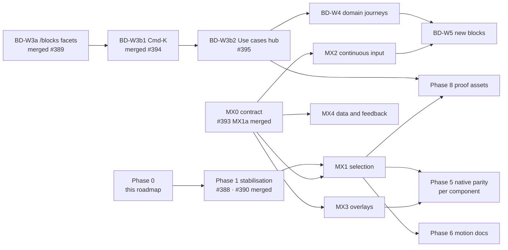

# Product roadmap: motion, components, business discovery and adoption

**Written:** 2026-10-17 · **Baseline:** `main` at `f586c12` (#388; first written on `a6019a1`, refreshed on `4c6a0af`) · **Status:** plan, not a record of shipped work.

This document coordinates four workstreams so they can move in parallel without colliding:

| | Workstream | Existing plan it builds on |
| --- | --- | --- |
| A | Component quality and interaction maturity | [`ANGULAR-GRADUATION.md`](../../ANGULAR-GRADUATION.md), `verification.json` |
| B | Motion foundations and cross-platform animation | `tokens/primitives/motion.json`, the motion gates listed in §2.5 and §8 |
| C | Business discovery and workflow-based navigation | [`BUSINESS-CAPABILITY-ROADMAP.md`](../BUSINESS-CAPABILITY-ROADMAP.md) §6 (Business Discovery W1) |
| D | Documentation, marketing and adoption | [`marketing/roadmap.md`](../../marketing/roadmap.md), [`marketing/analytics.md`](../../marketing/analytics.md) |

It does not replace any of those. The business capability roadmap stays the source for *what* business capabilities
exist and in which phase; this document only orders the motion, discovery and adoption work around it. The marketing
roadmap and the Qualified Evaluation Rate definition (`marketing/analytics.md` §2–§3) are unchanged by it.

**How to read the status words.** *Shipped* means merged to `main`. *Evidence* means a marker in `verification.json`
earned by a test or a browser gate. *Source* means the files exist, nothing more. A row that says source is not a
claim that the behaviour works on that platform.

---

## 1. Naming

Two of the brief's labels collide with names already in use, so this roadmap uses:

| Brief | Used here | Why |
| --- | --- | --- |
| Motion phases / waves | **MX0–MX4** | IoT milestones already use M1–M5 (#308 … #375). |
| Discovery waves | **BD-W2 … BD-W5** | Continues Business Discovery W1; "Wave 3" is already the Website Dogfooding adoption audit. |
| Brief phases 0–8 | **Phases 0–8** below | Only used inside this document. |

## 2. Verified baseline (2026-10-17)

### 2.1 Repository

| Fact | Value | Source |
| --- | --- | --- |
| `main` | `f586c12` — #388 SegmentedControl black fill + travelling Tabs indicator (previous refresh: `4c6a0af`, #394) | `git log` |
| Recently merged | #385 IoT sliders on library Slider · #386 speed-dial Fab example · #387 range Slider · #389 `/blocks` discovery · #394 Blocks and Use cases in Cmd-K · #391 Angular consumer vitest peer · #390 Angular SegmentedControl forced colours · #393 MX1a motion contract · #388 Tabs indicator | `git log` |
| Package versions on `main` | `@kinetixui/ui` 0.24.0 · `tokens` 0.24.0 · `cli` 0.24.0 · `angular` 0.25.1 · `iot` 0.5.0 | `packages/*/package.json` |
| Unreleased changesets | 15 in `.changeset/` (ui minor line incl. #387 Slider patch and #388, Angular waves incl. #390); IoT changesets held in `.changeset-held/iot/` | `.changeset/` |
| Catalogue | 109 entries; React 109 · Angular 80 · SwiftUI 90 · Compose 90 · Flutter 90 | `platform-parity.json` |
| Platform maturity | React stable · Angular **preview** · SwiftUI / Compose / Flutter stable (source; not published to SPM / Maven / pub.dev) | `platform-parity.json` `platformDefinitions` |
| Blocks | 21 (13 cited by shipping capability rows, 8 in `discovery.unclassifiedBlocks`) | `blocks.manifest.json`, `docs/business-capabilities.json` |
| Discovery data | 8 domains (pages: commerce, travel-booking) · 15 capability groups · 4 workflows (checkout, flight-booking, money-transfer, device-pairing) | `docs/business-capabilities.json` `discovery` |
| Angular graduation | 7 of 13 criteria met; open: 27 entries still planned, `timeline` missing `rtl` and `largeText` (both kinds, incl. browser), `tabs` missing `reducedMotion` (both kinds; #388 gave React that evidence, so Angular now owes it) | `node scripts/check-angular-graduation.mjs` |

### 2.2 Evidence totals

From `verification.json` `totals`. These are evidence markers, not component counts, and `visual` is 0 everywhere
because rendered visual gates are tracked by `scripts/visual-gates.mjs`, not by this file.

| | build | interaction | accessibility | rtl | largeText | reducedMotion |
| --- | --- | --- | --- | --- | --- | --- |
| React | 109 | 48 | 109 | 36 | 39 | 4 |
| Angular | 80 | 80 | 80 | 47 | 53 | 23 |
| SwiftUI | 90 | 0 | 0 | 0 | 0 | 7 |
| Compose | 90 | 7 | 6 | 1 | 0 | 7 |
| Flutter | 90 | 6 | 5 | 58 | 58 | 7 |

The native columns are the honest gap: 90 components build on each native platform, but almost none carry
interaction or accessibility evidence. Section 5 is planned around that.

### 2.3 Open pull requests (re-checked 2026-10-17, ~15:35 UTC)

| PR | What | State | Owner |
| --- | --- | --- | --- |
| #395 | BD-W3b2a: `/capabilities` becomes the Use Cases hub | open, ready for review | Use cases hub thread |
| #348 | Version packages (changesets) | open; **not touched by this roadmap** | release |
| #325 | IoT M4C-A harness | superseded by #342; **not touched** | — |

### 2.4 Work in flight elsewhere (do not duplicate)

| Work | Where |
| --- | --- |
| **MX1 selection interactions**: MX1a merged as #393; MX1b-1 (React Toggle, ToggleGroup, Checkbox, RadioGroup, Switch regression) is next, starting with Toggle and ToggleGroup | MX1 thread, from Ziad's MX1 and MX1b-1 briefs |
| BD-W3b2 Use cases hub: W3b2a is #395 (BD-W3b1 merged as #394) | "Use cases hub and global search" thread |
| Website Dogfooding Wave 3 adoption audit | its own thread |

### 2.5 Motion baseline

Verified in the Phase M0 audit (project file `motion-and-discovery-w2/01-MOTION-AUDIT.md`, re-checked on `a6019a1`; what #393 and #388 changed is noted inline):

- **One token source.** `tokens/primitives/motion.json`: durations `instant` 100 · `fast` 200 · `base` 300 · `slow`
  500 · `slower` 1000 ms; easings `linear`, `standard`, `enter`, `exit`, `emphasized`. Generated to CSS variables,
  the Tailwind preset, SwiftUI, Compose and Flutter; Angular reads the CSS variables.
- **The brief's candidate tiers do not match the shipped tokens.** It proposes `normal` 300 and `slow` 400; the source
  has `base` 300 and `slow` 500. Ziad decided (D1, §10): shipped names and values stay; selection-state motion uses
  `fast` 200 ms and press feedback `instant` 100 ms where it applies. #393 (merged) records this in `tokens/contracts/motion.json` and `MOTION.md`.
- **Reduced motion.** React: a global 0.01 ms floor in the preset plus explicit loop stops. Angular: per-component
  media blocks, no global floor. SwiftUI / Compose / Flutter: family helpers (disclosure, switch, loop; slide on
  SwiftUI only) reading the platform setting.
- **Gates.** `motion-contract.test.ts`, `check:motion-tokens` (#393), `check:motion` (Accordion, Collapsible, Switch
  and, since #388, Tabs midpoints), `check:tabs-indicator` (#388), `check:loop-motion`,
  `check:native-motion` (with a `KNOWN_GAPS` ledger), `check:registry-motion`, Angular browser motion steps.
- **Known gaps** (G-numbers from the audit): G1 no default transition duration (about 24 components run Tailwind's
  untokenised 150 ms; #393 froze them in a debt register so none can be added, and each is retimed in its own slice); G2 no stagger/delay tokens (#393 decided stagger stays untokenised while it has one consumer); G3 library `Chart` (Recharts) ignores reduced motion; G4 `/docs/tokens`
  said `duration.instant` and `easing.enter/exit` were unconsumed (fixed by #393); G5 Angular has no global floor; G6 Menubar has no exit animation; G7 Progress fills
  with a physical `translateX` (RTL unmeasured); G9 no per-component motion docs; G10 native ledger gaps; G11 no
  layout-transition policy; G12 gesture tokens unwired.

#393 closed G4 and settled G2 and the token naming question; working down G1's debt register belongs to the MX1
thread (§2.4). This roadmap lists them for dependency purposes only.

## 3. Phases and dependencies

| Phase | Scope | Depends on | Status |
| --- | --- | --- | --- |
| 0 | Reconcile and plan (this document) | — | this PR |
| 1 | Finish #388 verification; #390 Angular forced colours | — | done (#388, #390 merged) |
| 2 / MX0 | Semantic motion contract, default transition tier, stagger/delay, reduced-motion and RTL rules, gates | D1 (decided) | done (#393 merged, MX1a); the default tier (G1) is frozen as a debt register and retimed per component in MX1b |
| 3 / MX1–MX4 | Component animation waves | MX0 (#393 merged) | MX1b-1 next; MX2–MX4 planned |
| 4 / BD-W3b–W5 | Search, Use cases hub, journeys, new blocks | BD-W3a (merged) | W3b1 merged (#394); W3b2a open (#395); W4–W5 planned |
| 5 | Native parity, one component family per PR | MX1, MX3 contracts | planned |
| 6 | Motion and business documentation, live demos | MX1 | planned |
| 7 | Verification (applies to every PR) | — | standing |
| 8 | Marketing proof assets and adoption measurement | each milestone | standing |

## 4. Motion and component matrix (MX1–MX4)

Platforms: R React · A Angular · S SwiftUI · C Compose · F Flutter. **src** = source exists; **RM** = a
`reducedMotion` evidence marker in `verification.json`; **—** = not in the catalogue for that platform. Nothing here
claims runtime parity; see §5. **Gate** is what runs today: `check:motion` measures midpoints only for the components
in `scripts/motion-states.mjs` (Accordion, Collapsible, Switch, Tabs), in LTR; the `*-visual` gates check rendered
states (rest, hover, selected, focus), not motion; `motion-contract` is a class-string test, not a render.

| Wave | Component | R | A | S | C | F | Trigger → property | Planned work | Gate |
| --- | --- | --- | --- | --- | --- | --- | --- | --- | --- |
| MX1 | Tabs | src | src | src | src | src | selection → indicator inline offset + size | React done (#388); promote the contract's `selection-indicator` role (still `proposed`, no consumer, in `tokens/contracts/motion.json`) to proven with the Tabs consumer and its midpoint evidence (MX1 thread); Angular / native after | `check:motion` midpoint, `check:tabs-indicator` |
| MX1 | SegmentedControl | src | src | src | src | src | selection → fill | done (#388, #390) | `selection-visual`, forced colours |
| MX1 | Switch | RM | RM | RM | RM | RM | toggle → thumb inline offset, track colour | add rendered RTL thumb-travel assertions: an RTL case in `motion-states.mjs` for web, native UI tests for SwiftUI and Compose (Flutter's suite already asserts RTL) | `check:motion` (LTR only), `check:native-motion` (reduced-motion wiring, not direction) |
| MX1 | Checkbox / RadioGroup | src | src | src | src | src | check → mark opacity / scale | decide whether any motion is warranted | `selection-visual` |
| MX1 | Toggle / ToggleGroup | src | src | src | src | src | press → colour | default-tier fix (G1) | `motion-contract` (class strings) |
| MX1 | NavigationMenu | src | RM | — | — | — | open → content enter / exit | web only by design; add it to `motion-states.mjs` so `check:motion` measures it | none yet |
| MX1 | TabBar | src | src | src | src | src | selection → active indicator | follows Tabs contract | `navigation-visual` |
| MX2 | Slider (incl. range) | src | src | src | src | src | drag / key → thumb, range | value text, marks, vertical; native spoken value | a11y-browser, native tests |
| MX2 | Progress / CircularProgress | src | src | src | src | src | value → fill | logical fill (G7, measure first); native ledger gap | new RTL probe |
| MX2 | Tick / ruler picker | — | — | — | — | — | — | composition recipe on Slider, not a component | — |
| MX3 | Dialog, AlertDialog, Drawer, Popover, Tooltip, HoverCard, Menu family (Sheet is the contract's separate `spatial` role; React Drawer is split out below) | src | RM | src | src | src | open / close → opacity, translate, scale | Menubar exit (G6); Angular global floor (G5); Compose and Flutter overlay enter / exit (none today, §5) | state only: `overlay-visual`, `menu-visual`; no motion gate yet (add overlay cases to `motion-states.mjs`) |
| MX3 | Drawer (React) | src | row above | row above | row above | row above | open / drag → translate | motion comes from Vaul (fixed 500 ms curve, no Kinetix tokens): record it in the contract's `spatial` role or a gesture role, align or document the curve, then gate it | none yet |
| MX3 | Accordion / Collapsible | RM | RM | RM | RM | RM | expand → height | already gated; keep | React `check:motion`; Angular `check:angular-browser`; native `DisclosureMotion` unit tests (SwiftUI, Compose, Flutter) and `check:native-motion` (wiring) |
| MX4 | Chart | src | — | src | src | src | mount → series draw | reduced motion for Recharts (G3); native charts render statically, so they need none unless they gain motion | new browser assertion |
| MX4 | Skeleton / Spinner / indeterminate CircularProgress | src | src | RM | RM | RM | loop | React gated by `check:loop-motion` (Storybook Spinner and Skeleton, React only); Angular's Spinner and indeterminate CircularProgress slow instead of stopping (§5) and no runtime loop gate covers them: decide both with G5 and gate both | `check:loop-motion` (React); Angular: none |
| MX4 | Sonner, Alert, Banner | src | src / RM | src | src | src | appear → enter | the #393 contract has no role for feedback entry: add one (or record each as static by design), then gate it | — (none yet) |

**Per-component spec.** Every MX PR states, for each component it touches: interaction states · trigger · property ·
duration and easing token · interruption (retarget from the current value, no queued animations) · RTL (logical
properties, mirrored offsets) · reduced-motion form (same end state, instant or opacity only) · keyboard and
screen-reader behaviour (state changes are never delayed by motion) · test strategy (unit for logic, real browser for
geometry and timing, native tests for native behaviour).

## 5. Cross-platform parity matrix (motion behaviours)

Statuses: **V** implemented and runtime-verified by a gate · **I** implemented, not runtime-verified · **P** partial ·
**Pl** planned · **NA** not applicable.

| Behaviour | React | Angular | SwiftUI | Compose | Flutter |
| --- | --- | --- | --- | --- | --- |
| Motion tokens generated from one source | I (contract test checks class-string wiring, not runtime) | I (reads the CSS variables; no gate inspects computed values) | I | I | I (`flutter-tokens` test checks values) |
| Disclosure (Accordion / Collapsible) motion + reduced form | V (`check:motion`) | V (browser) | I (helper + unit tests) | I | I |
| Switch motion + reduced form | V | V | I | I | I |
| Loop stop under reduced motion | V for Spinner and Skeleton (`check:loop-motion`); I for Marquee, MessageBubble and the InputOTP caret, which no browser gate covers | P (Skeleton and Marquee stop; Spinner and indeterminate CircularProgress slow to 3 s by design rather than stopping; no global floor, G5) | I | I | I |
| Sliding selection indicator (Tabs) | V (`check:motion` midpoint and `check:tabs-indicator`, #388) | Pl | Pl | Pl | Pl |
| Overlay enter / exit with directional easing | P (Menubar has no exit animation, G6; Drawer uses Vaul's fixed 500 ms curve with no Kinetix tokens; the other overlays I, contract test checks tokens, not rendered timing; Sheet is the `spatial` role, `observed`, not this behaviour) | I (the browser `reducedMotion` pass measures duration, midpoint and end state, not easing) | P (Sheet / Sidebar / Toaster slide helper, Dialog fade only; ledger) | Pl (Dialog and Sheet show and hide without animation; no ledger family) | Pl (`KinetixDialog` and `KinetixSheet` switch between `SizedBox.shrink()` and the overlay; no ledger family) |
| Default transition duration on every transition | P (G1) | I | NA | NA | NA |
| Chart reduced motion | Pl (G3) | NA (no Angular Chart) | NA (renders statically, no mount animation) | NA (static) | NA (static) |
| RTL-correct motion direction | P (Switch; Tabs indicator geometry measured under RTL by `check:tabs-indicator`) | P (`rtl` evidence 47) | Pl | Pl | P (`rtl` evidence 58, layout not motion) |
| Runtime change of the reduced-motion setting | I (media query) | I | I (`@Environment`) | I (observer) | I (`MediaQuery`) |

Native rows are I at best because `check:native-motion` proves that each animating file references the platform
setting and that tests cover both directions; it does not render on a device. A native **V** needs a UI test on a
simulator or emulator, which is the first item of Phase 5.

## 6. Business-discovery matrix

| Wave | Slice | State | Gate | Depends on |
| --- | --- | --- | --- | --- |
| BD-W1 | Capability data, `/components` business filters, `/capabilities`, `/use-cases/{commerce,travel-booking}` | shipped (#377) | `check:capabilities` | — |
| BD-W2a | Tag blocks with business metadata; `unclassifiedBlocks` ledger | shipped (#389) | `check:capabilities`, `check:block-source` | W1 |
| BD-W3a | `/blocks` facets (q, cat, capability, domain, workflow, platform) | shipped (#389) | `check:blocks-discovery` | W2a |
| BD-W3b1 | Cmd-K groups for Blocks and published Use cases from a static projection | shipped (#394) | see #394 | W3a |
| BD-W3b2 | `/capabilities` as the Use cases hub; page criteria for domains | W3b2a open (#395) | generator criteria + negative controls; a11y-site | W3b1 |
| BD-W4 | Evidence-backed domain journeys (finance first if it meets the page criteria) | planned | `check:capabilities` refuses a page with nothing shipping | W3b2 |
| BD-W5 | New business blocks, only for composition gaps a journey exposed | planned | `check:block-source` (five platforms), `check:blocks` | W4, MX2 |

Rules carried forward: no second taxonomy (everything reads `docs/business-capabilities.json`); planned rows never
link to a component; Pro-candidate rows never reach the site (`marketing/STRATEGY.md` rule 7).

## 7. PR sequence

One work package per PR. Motion, discovery and native parity never share a PR.

| # | PR | Workstream | Owner | Blocked by |
| --- | --- | --- | --- | --- |
| 1 | **This roadmap** (docs only) | all | this thread | — |
| 2 | #388 finish, #390 | A / B | restyle thread | done (merged) |
| 3 | MX1a motion foundation (#393, merged), then MX1b-1 React selection motion | B | MX1 thread | — |
| 4 | BD-W3b2 Use cases hub (W3b1 merged as #394; W3b2a is #395) | C | use-cases thread | — |
| 5 | MX4a Chart reduced motion (G3) | B | unassigned | — (a chart draw is a finite entry, not a `loop`: add a finite entry role to the #393 contract or apply its general reduced-motion shortening rule) |
| 6 | Angular `timeline` RTL + large-text evidence (closes 3 of 6 open graduation criteria) | A | unassigned | — |
| 7 | MX3a Menubar exit (G6) + Angular global reduced-motion floor (G5) | B | unassigned | — (#393 merged) |
| 8 | MX2a Progress logical fill (G7), measured in RTL first | B | unassigned | — |
| 9 | MX2b Slider value text, marks, vertical (React), then native spoken value per platform | B / A | unassigned | #387 (merged) |
| 10 | Phase 5a: first native UI test (simulator / emulator) for Switch on one platform | A | unassigned | CI runner decision D4 |
| 11 | BD-W4 first journey | C | unassigned | BD-W3b2 |
| 12 | Phase 6 per-component Motion section on docs pages, generated from a motion spec | D | unassigned | MX1 |
| 13 | Angular Tabs travelling indicator + `reducedMotion` evidence, marker and browser (closes the 2 criteria #388 opened) | A / B | unassigned | #388 (merged) |

## 8. Verification strategy

Every PR runs, and its description records, what applies of: `pnpm typecheck` · `pnpm lint` · the changed packages'
unit tests · real-browser gates for any layout, focus, keyboard or timing claim (`check:a11y-browser`, `check:motion`,
the visual gates, `check:large-text`) · RTL · reduced motion (same end state) · forced colours · 200 % text (the library
gates, `check:large-text` and Angular's `largeText` pass, scale the root font size; site pages use CDP
`Page.setFontSizes`) · light and dark · registry and manifest checks
(`check:manifest`, `check:registry-deps`, `check:registry-motion`) · generators at a fixed point · bundle delta for
runtime changes · a negative control for any new or changed gate · CI green · Codex review.

What each instrument proves is stated narrowly: jsdom proves logic, not layout; a source scan proves wiring, not
rendering; a native unit test proves the helper's branches, not what a user sees on a device.

**This PR** is documentation only. It changes no source, token, generator or gate, so the applicable checks are: the
file renders on GitHub (Mermaid included), every repository path it names exists on `f586c12` except the one it
labels as outside the tree (the project file `motion-and-discovery-w2/01-MOTION-AUDIT.md`), every number in §2
was read from the file cited next to it and re-checked on `f586c12`, and CI stays green.

## 9. Marketing dependencies

The 30-day plan in `marketing/roadmap.md` and the Qualified Evaluation definition in `marketing/analytics.md` are not
changed. Each milestone produces proof that can feed it, but nothing is published or scheduled by this roadmap and no
publication status is implied.

| Milestone | Reusable proof | Fits |
| --- | --- | --- |
| #388 Tabs indicator | Before / after capture from the browser gate, reduced-motion end state | Campaign 1 ("prove parity"), X / LinkedIn short |
| MX1 motion contract | Token table across five platforms; negative-control story | dev.to article on motion tokens (follows ART-002's token-boundary theme) |
| BD-W3b Use cases hub | Walkthrough from "I build checkout" to blocks and code | LinkedIn, docs landing |
| Angular graduation progress | The executable graduation matrix | GitHub README, Angular audience |
| First native UI test | Evidence that a native claim is runtime-verified | Campaign 1 |

Measurement stays on the existing events. New discovery surfaces get attribution `source` values so existing link
and CTA events are counted; no new event is added without updating the arrival-event list the dashboard SQL encodes.

## 10. Risks and owner decisions

| # | Decision or risk | Recommendation |
| --- | --- | --- |
| D1 | Motion tier names and values | **Decided by Ziad (MX1b-1 brief):** keep shipped names and values (`base` 300, `slow` 500, `slower` 1000, easings unchanged); selection-state motion `fast` 200 ms; press feedback `instant` 100 ms where appropriate; no global retiming. |
| D2 | "Industry" vs "Business domain" as the UI label | Decide before BD-W3b2 ships. |
| D3 | "Use cases" in the main navigation | Decide with BD-W3b2. |
| D4 | Native UI tests need macOS (SwiftUI) and an Android emulator (Compose) in CI | Start with one platform and one component; the cost is CI minutes. |
| R1 | Parallel threads editing the same files (`tabs.tsx`, `segmented-control.tsx`, the motion gates) | Ownership table in §2.4; later PRs merge `main` and rerun gates. |
| R2 | Unreleased `ui` minor line keeps growing (#376, #385, #387, #388) | Release is a separate, explicit decision; this roadmap publishes nothing. |
| R3 | `verification.json` markers read as "verified" by a casual reader | Docs keep the source / evidence / runtime-verified distinction (§5). |
| R4 | Native "stable" maturity with near-zero native interaction evidence | Phase 5 adds runtime evidence before any new native claim. |

## 11. Next executable PR

After this roadmap, the smallest independent slice that no other thread owns is **#6 in §7: Angular `timeline` RTL and
large-text evidence.** It closes three of the six open Angular graduation criteria (RTL parity, large-text parity, and large text from a real browser) with one component, touches neither
motion files nor discovery files, and is measurable.

Acceptance criteria:

1. Reproduce: `node scripts/check-angular-graduation.mjs` reports `rtl` 21/22 and `largeText` 26/27, with `timeline`
   the missing component in both.
2. RTL: add `timeline` to the `rtl` pass of `scripts/angular-browser.mjs` (live Angular in Chromium), asserting
   logical geometry (marker and connector on the start side under `dir="rtl"`), not only that the attribute is set.
3. Large text: add `timeline` to the `largeText` pass of the same script, the browser instrument the graduation
   check requires, and fix any defect it finds in `packages/ui-angular` instead of allowlisting it.
4. Regenerate `verification.json` with `pnpm gen:verification`, then confirm the fixed point with `pnpm check:verification`; never hand-edit it.
5. The graduation check then reports 22/22, 27/27 and 27/27 for those three rows, leaving the planned-entries
   criterion and the two `tabs` reduced-motion criteria (§7 row 13) open.
6. Negative control: temporarily remove the fix or the new assertion and show the gate failing; restore it.
7. Angular's `maturity` stays `preview`: 27 catalogue entries are still planned.
