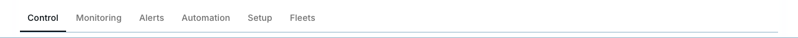

# Tabs and platform-filter dogfooding pass

Base: `origin/main` at `ae9cc44a`. Branch: `feat/tabs-platform-dogfood`.

## Audit and decisions

The React library's Tabs used an inset track and raised selected pill, duplicating SegmentedControl's mode-switch treatment. The IoT category strip, lab content panels, documentation implementation tabs and showcase mode controls used Radix directly with separate website class strings. Components category/platform/beta filters were plain buttons with a local `catButton` style function. No shared filter-chip API existed.

| Surface | Final control |
| --- | --- |
| IoT categories and secondary lab/example content panels | Library Tabs |
| Usage snippets, cross-platform flagship, systems implementation explorer | Library Tabs |
| ComponentPreview and Showcase | SegmentedControl for Preview/Code; Tabs for implementation platforms |
| IoT example Preview/Code | SegmentedControl; preview and source remain mounted, hidden when inactive |
| Components category/platform/beta facets, including mobile sheet | Library Toggle with pill treatment |
| IoT room/floor PillSelector | Retained compact radio option selector |
| ToggleGroup action demos and SegmentedControl demos | Retained their distinct control semantics |
| HeroSystemMap | Retained its diagram-specific Radix selection surface; converting its connected drawing to a standard navigation rail is outside this focused pass |

Existing package Tabs usages (including dashboard/content demos) are peer-content navigation. The audit found no need to retain the old contained Tabs treatment; no variant prop was introduced. SegmentedControl remains the enclosed local mode control.

## Exact library changes

- `Tabs`, `TabsList`, `TabsTrigger`, `TabsContent` keep their existing Radix props, refs and exports. The default presentation is a line treatment, with a 1px base rail, reserved 2px active border, foreground indicator, transparent background and constant font weight. Lists scroll locally rather than widening the page. Focus reveals the tab without scrolling the document. Vertical lists use a logical inline-end rail.
- Tabs uses existing `duration-fast` and `ease-standard` for color transitions. There is no moving indicator or layout animation. Reduced motion is explicitly suppressed; the site's global floor computes as 0.01ms. Forced colors has a system-color outline fallback for keyboard focus.
- SegmentedControl retains its enclosed track and raised active segment. It can wrap, has a zero minimum width, respects reduced motion and provides a forced-colors focus outline. Touch targets use the existing coarse-pointer utility. Mode callers reject an empty selection. The installed Radix single-select primitive exposes `radiogroup` / `radio` and `aria-checked`; tests now assert these semantics.
- Toggle adds `variant="pill"` and `leadingIcon?: React.ReactNode`. The icon slot is decorative (`aria-hidden`), uses the inherited reading direction and scales with text. Pills use automatic height, wrapping-friendly dimensions, existing selection tokens and a selected outline plus `Canvas` / `CanvasText` in forced colors. Normal chip backgrounds remain on KinetixUI tokens.
- ToggleGroup derives its variant types from shared `toggleVariants`, so its generated API also recognizes `pill`; no action groups were migrated to navigation.
- Package and CLI registry payloads, API specs, Toggle Storybook controls, usage docs and a patch changeset are synchronized.

## Website migration and icon source

Removed direct Radix imports and local tab styles from the eight affected navigation/showcase wrappers. Removed the gallery's local chip style function. URL facet behavior, platform preferences, analytics, hash links, lazy panel mounting and IoT demo state retention remain covered by existing tests.

All five platform marks reuse `apps/web/src/components/platform-logo.tsx`, already the canonical monochrome source used by the ticker. Its documented source is Simple Icons 16.34.0: React, Angular, Swift, Jetpack Compose and Flutter. Swift represents SwiftUI, and Compose uses its product mark. No dependency, remote asset, invented logo or brand-colored background was added. The SVGs inherit `currentColor`, are 16px at normal text size, grow with enlarged text, are not focusable, and are hidden from screen readers. Platform names, maturity and counts remain visible and accessible.

The browser sweep found and repaired a doubled-text IoT layout defect: the mode/copy row now wraps, and the containing content grids use zero-minimum single columns. These changes affect layout only.

## Build prerequisite

The initial baseline `/iot` could not render because tsup's shared React chunk dropped source client boundaries. `preserve-iot-client-boundaries.mjs` now restores them on emitted React modules and the React barrel after each IoT build. The mixed package root and pure functions graph stay server-importable. `check:iot-dist` rejects React modules without boundaries and pure modules with client directives. A fresh IoT build followed by the production site build passed; no manual generated-file workaround is required. No IoT model, transport or business logic was changed.

## Verification

| Check | Result |
| --- | --- |
| UI unit/a11y/keyboard suite | 16 files, 437 tests passed |
| Website unit suite | 95 files, 2,034 tests passed |
| Release tooling suite | 263 passed, 5 skipped, 0 failed |
| UI + web lint | Passed; two existing unused-variable warnings in `marketing-claims.test.ts`, plus the existing JSX analyzer notice |
| UI + web typecheck | Passed |
| Tokens, UI, IoT, CLI registry and production website builds | Passed; all 139 website pages generated |
| RTL, icon mapping, registry dependencies, registry motion, generated stories, IoT distribution checks | Passed |
| `git diff --check` | Passed |
| Focused production browser gate | All 8 cases passed |

The browser gate covers desktop light, desktop dark RTL, 320px phone, dark RTL phone, 320px phone at 200% text, dark RTL phone at 200% text, tablet at 200% text, and forced colors. It checks reading-order arrow keys, Home/End focus, active state, local focused-tab visibility, stable font weight, reduced-motion suppression, normal-motion availability, focus indication, transparent active tabs, page reflow, decorative icon dimensions/order, keyboard filter activation, and axe on the affected navigation/filter surfaces. This is focused accessibility evidence, not a claim that every page and every interactive IoT state was audited. Browser measurements are saved in `browser-results.json`; commands/results are in the adjacent logs.

Rerun with `pnpm check:tabs-dogfood` against a production server on port 3123, or set `TABS_BASE`. `PLAYWRIGHT_CHROMIUM_PATH` can select a browser; otherwise the gate uses local macOS Chrome when present or Playwright's installed Chromium.

## Bundle impact

The complete built UI ESM entry grows from 329,593 to 331,484 bytes: **+1,891 bytes raw, +410 bytes gzip**. This includes the shared APIs and styles. No dependency or lockfile change. IoT packaging adds two client directives. The final site build reports 493kB first-load JS for Components and 507kB for IoT; a production website baseline delta was not measured, so these are absolute sizes, not a claim of zero website impact. See `bundle-impact.json` and `build.log`.

## Before / after

Matched desktop screenshots use Control as the selected IoT category and the unfiltered platform row. Additional keyboard-focus captures are included.

| Surface | Before | After |
| --- | --- | --- |
| IoT top navigation |  |  |
| Components platform filters |  |  |

## Merge recommendation

Locally ready for review and merge after GitHub's required checks pass. Review the intentional default Tabs visual change and the narrowly scoped client-boundary packaging prerequisite. No merge or package publication has been performed. Native-platform Tabs implementations were not restyled by this React website pass.

## Files changed

- `.changeset/clean-tabs-platform-filters.md`
- `apps/web/public/r/segmented-control.json`
- `apps/web/public/r/tabs.json`
- `apps/web/public/r/toggle.json`
- `apps/web/public/specs/toggle-group.json`
- `apps/web/public/specs/toggle.json`
- `apps/web/src/app/docs/components/tabs/page.mdx`
- `apps/web/src/app/docs/components/toggle/page.mdx`
- `apps/web/src/app/iot/page.tsx`
- `apps/web/src/components/analytics-instrumentation.test.tsx`
- `apps/web/src/components/component-gallery.test.tsx`
- `apps/web/src/components/component-gallery.tsx`
- `apps/web/src/components/component-onboarding.test.tsx`
- `apps/web/src/components/component-preview.tsx`
- `apps/web/src/components/cross-platform-flagship.tsx`
- `apps/web/src/components/iot/example-showcase.tsx`
- `apps/web/src/components/iot/lab/category-explorer.tsx`
- `apps/web/src/components/iot/lab/lab-tabs.tsx`
- `apps/web/src/components/showcase.analytics.test.tsx`
- `apps/web/src/components/showcase.direction.test.tsx`
- `apps/web/src/components/showcase.tsx`
- `apps/web/src/components/systems/explorer-tabs.tsx`
- `apps/web/src/components/systems/systems-in-motion.test.tsx`
- `apps/web/src/components/usage-example-tabs.tsx`
- `apps/web/src/lib/blocks.test.tsx`
- `apps/web/src/lib/platform-preference.test.tsx`
- `evidence/tabs-dogfood/README.md`
- `evidence/tabs-dogfood/after-iot-keyboard.png`
- `evidence/tabs-dogfood/after-iot.png`
- `evidence/tabs-dogfood/after-platforms-keyboard.png`
- `evidence/tabs-dogfood/after-platforms.png`
- `evidence/tabs-dogfood/before-iot.png`
- `evidence/tabs-dogfood/before-platforms.png`
- `evidence/tabs-dogfood/browser-results.json`
- `evidence/tabs-dogfood/bundle-before.json`
- `evidence/tabs-dogfood/bundle-impact.json`
- `package.json`
- `packages/iot/package.json`
- `packages/ui/src/components/segmented-control.tsx`
- `packages/ui/src/components/tabs.tsx`
- `packages/ui/src/components/toggle.tsx`
- `packages/ui/src/stories/Toggle.stories.tsx`
- `packages/ui/src/tabs-filters.test.tsx`
- `registry/kinetixui/ui/segmented-control.tsx`
- `registry/kinetixui/ui/tabs.tsx`
- `registry/kinetixui/ui/toggle.tsx`
- `scripts/check-iot-dist.mjs`
- `scripts/gen-stories.mjs`
- `scripts/preserve-iot-client-boundaries.mjs`
- `scripts/tabs-dogfood-browser.mjs`
- `specs/components/toggle-group.json`
- `specs/components/toggle.json`
